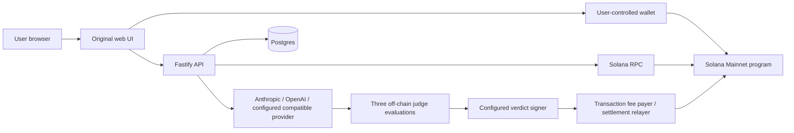

# Architecture

## Components
1. Browser: wallet connection, drafts, user transaction approval, Arena, Practice, Guard, Shield and owner controls. It never receives server wallet keys or provider credentials.
2. API: schema/rate validation, wallet authorization, prepared transactions, chain confirmation, encrypted configuration, AI execution, judge aggregation and settlement retry/refund handling.
3. Postgres: metadata, encrypted private instructions/canaries/custom credentials, attempts, public outcomes, Guard key hashes and owner/month usage. Source migrations are not a database export.
4. Chain: Config, Sentinel and Attack PDAs. Holds SOL, checks signer/account/seed constraints, escrows attack fees, verifies judge Ed25519 evidence and handles payout/refund/owner actions.
5. Provider adapters: Anthropic and OpenAI-compatible calls with bounded context/output handling. Real provider failures remain failures.
6. Background work: retries pending outcomes and synchronizes on-chain state; it does not invent successful transactions when RPC/provider work fails.

## Trust boundaries
Wallet message authorization is not permission to spend SOL. Only the intended wallet approves its transactions. A prepared unsigned transaction is not funding evidence. Server metadata is not a substitute for a real account/receipt.

Three model evaluations are not three independently controlled on-chain signers. The contract trusts the configured aggregate judge signer. The signer/relayer must be protected separately from admin/deployer and owner wallets.

The program is upgradeable. Administrators can change configured roles/pause/cap; bytecode and authority must be checked again after changes. The token reserve is a transfer destination, not a burn mechanism.

## Source map
- heisto-app/server/src/app.ts: routes and operation coordination.
- heisto-app/server/src/lib/chain.ts: transactions, confirmation and decoding.
- heisto-app/server/src/lib/judge.ts and jury.ts: evaluation/aggregation.
- heisto-app/server/src/lib/practice.ts: AI-only challenges.
- heisto-app/server/src/lib/guard*.ts: normalization, scoring, monthly quotas.
- heisto-app/server/src/lib/crypto.ts: encryption and authorization.
- heisto-contracts/programs/heisto/src/lib.rs: authoritative on-chain rules.
- heisto-sdk/src/index.ts: binary layouts and instruction/PDA encoding.
