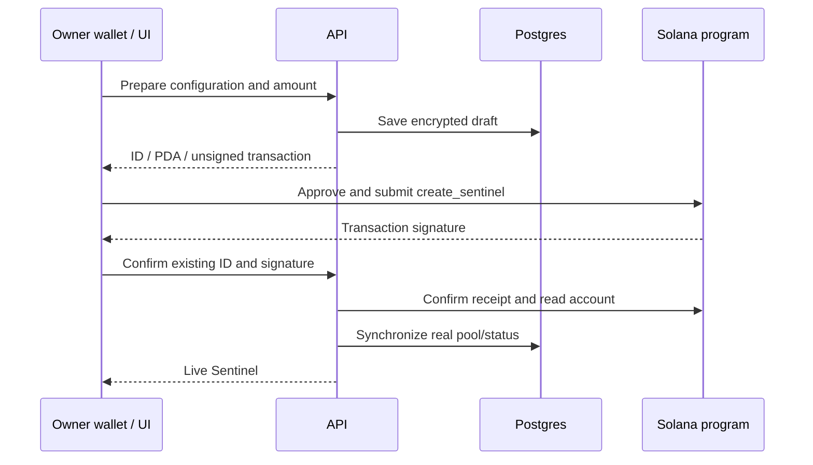

# Application flows

## Funded Sentinel creation
Model → name → public/private instructions → goal/jury/canary → pool/fee → review → prepare draft → owner signs → chain confirms → API verifies owner/hash → production live record.

If confirmation is uncertain, reconcile the same ID/signature. Do not create another funded pool as a retry.

## Paid attack
Attacker prepares a prompt → API hashes prompt and quotes current fee → wallet approves request_attack → program escrows fee → API confirms receipt/hash → agent response → three model evaluations → aggregate verdict → configured judge signs bound verdict → relayer submits Ed25519 verification plus settle_attack → program applies fee allocations and eligible payout → API stores/synchronizes the actual receipt.

User fee approval does not authorize unrelated transfers. max_fee limits a changed quote. If a provider or RPC fails, leave an honest pending/failed state. An eligible unsettled Attack can be refunded after 15 minutes. A displayed score alone is not payout proof.

## Owner lifecycle
Fund adds SOL and resets the seven-day lock. Claim withdraws accrued defender fees. Deactivate stops new attacks. Withdraw requires owner signature, deactivated status, lock expiry and at least 24 hours after deactivation. It pays remaining pool/fees, not an automatic account closure/refund of all rent.

## AI-only Practice
Public catalog → signed wallet message → owner UTC-day quota → actual provider completion and judging → result. No pool, SOL transaction or prize payout is implied. Private challenge judge explanations are withheld from public output to avoid disclosing their protected value; actual agent responses are preserved.

## Guard
Public text checker → bounded heuristic score, not a calibrated security probability. Signed wallet manages keys → server returns a new key once and stores its hash → bearer key calls /v1/guard → owner/month usage atomically consumed across credentials. Rotation/revocation never restores already consumed owner allowance.

## Profile / Shield / leaderboard
Views read actual metadata and recorded outcomes. Empty histories remain empty. Advice is not proof of agent security. Wallet authentication for private management must be validated independently of a public profile address.
